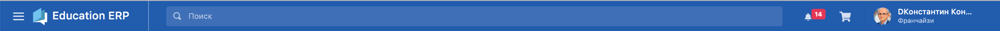
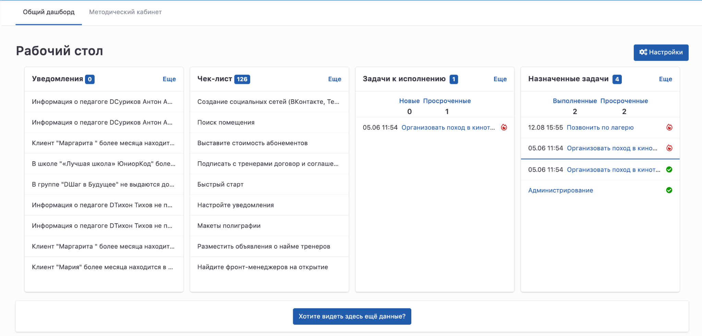
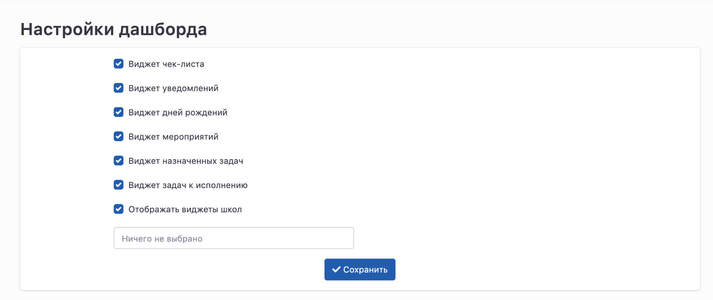
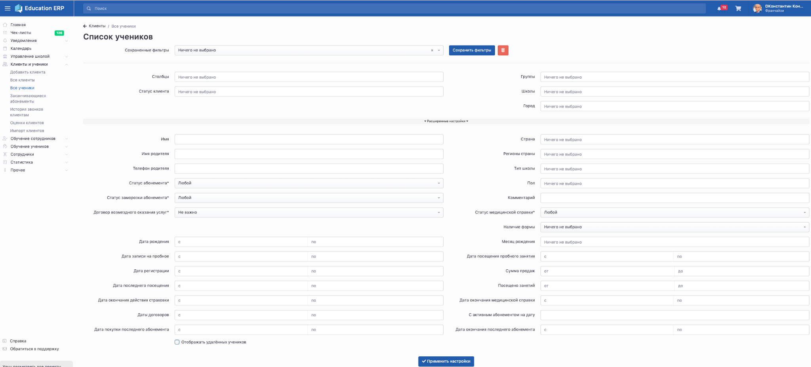
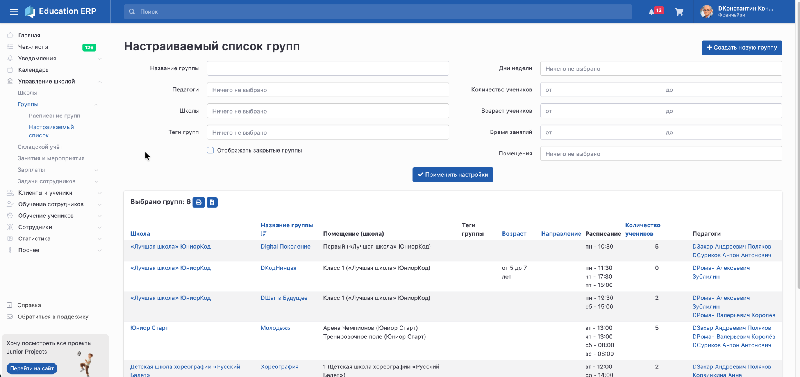

[html]

  

    

      Интерфейс Education ERP построен вокруг главного меню, рабочего стола,
      поиска и рабочих страниц. Разберём основные элементы, которые помогут
      быстро ориентироваться в системе.
    

  

  <h2 style="margin:0 0 10px;color:#202939;font-size:22px;">
    1. Верхняя панель
  </h2>

  

    Верхняя панель доступна во время работы в системе и содержит основные
    элементы быстрого доступа.
  

[/html]

{width=2048px height=64px}

[html]

[/html]

[html::780px]

  

    

      <strong style="display:block;margin-bottom:4px;">☰ Главное меню</strong>
      
        Кнопка позволяет свернуть или развернуть боковое меню.
      
    

    

      <strong style="display:block;margin-bottom:4px;">🔎 Поиск</strong>
      
        Глобальный поиск по данным Education ERP.
      
    

    

      <strong style="display:block;margin-bottom:4px;">🔔 Уведомления</strong>
      
        Быстрый доступ к уведомлениям. Счётчик показывает их количество.
      
    

    

      <strong style="display:block;margin-bottom:4px;">Профиль пользователя</strong>
      
        В правой части отображаются пользователь и его текущая роль.
      
    

  

  <h2 style="margin:0 0 10px;color:#202939;font-size:22px;">
    2. Поиск
  </h2>

  

    Строка поиска расположена в верхней части Education ERP и доступна
    независимо от того, в каком разделе системы вы находитесь.
  

  

    

      Через глобальный поиск можно найти:
    

    

      Клиентов
      Учеников
      Сотрудников
      Информационные материалы
    

  

  

  <h2 style="margin:0 0 10px;color:#202939;font-size:22px;">
    3. Главное меню
  </h2>

  

    Слева расположена основная навигация Education ERP.
    Пункты со стрелкой можно раскрывать для перехода к подразделам.
  

[/html]

[image:./interfeys-education-erp-8.webp:::0,0,100,100:321px::558px:1159px:center]

[html]

  

    

      <strong>Главная</strong>
       — рабочий стол пользователя.
    

    

      <strong>Чек-листы</strong>
       — работа с чек-листами.
    

    

      <strong>Уведомления</strong>
       — уведомления и рассылки.
    

    

      <strong>Календарь</strong>
       — календарь и события.
    

    

      <strong>Управление школой</strong>
       — школы, группы, занятия и другие инструменты управления.
    

    

      <strong>Клиенты и ученики</strong>
       — работа с клиентами и учениками.
    

    

      <strong>Обучение сотрудников</strong>
       — инструменты обучения сотрудников.
    

    

      <strong>Обучение учеников</strong>
       — инструменты обучения учеников.
    

    

      <strong>Сотрудники</strong>
       — работа с сотрудниками.
    

    

      <strong>Статистика</strong>
       — статистика и показатели работы.
    

    

      <strong>Прочее</strong>
       — дополнительные возможности системы.
    

  

  

    В нижней части меню находятся <strong>«Справка»</strong> и
    <strong>«Обратиться в поддержку»</strong>.
  

  

  <h2 style="margin:0 0 10px;color:#202939;font-size:22px;">
    4. Главная и рабочий стол
  </h2>

  

    После входа в Education ERP пользователь попадает на Главную.
    Здесь расположен рабочий стол с информационными виджетами.
  

[/html]

{width=2048px height=981px}

[html]

  

    На рабочем столе может отображаться актуальная информация из разных
    разделов системы.
  

  

    

      <strong>Уведомления</strong>
    

    

      <strong>Чек-лист</strong>
    

    

      <strong>Задачи к исполнению</strong>
    

    

      <strong>Назначенные задачи</strong>
    

  

  

    <strong>Обратите внимание.</strong>
    Состав рабочего стола можно настроить под себя.
  

  

  <h2 style="margin:0 0 10px;color:#202939;font-size:22px;">
    5. Настройка рабочего стола
  </h2>

  

    Чтобы изменить состав рабочего стола, на Главной нажмите
    <strong>«Настройки»</strong>.
  

  

    Главная
    →
    Настройки
  

[/html]

{width=2048px height=863px}

[html]

  

    В настройках можно выбрать, какие виджеты будут отображаться на рабочем столе:
  

  

    ✓ чек-лист 
    ✓ уведомления 
    ✓ дни рождения 
    ✓ мероприятия 
    ✓ назначенные задачи 
    ✓ задачи к исполнению 
    ✓ виджеты школ
  

  

    Если включено отображение виджетов школ, выберите необходимые школы.
    После изменения настроек нажмите <strong>«Сохранить»</strong>.
  

  

  <h2 style="margin:0 0 10px;color:#202939;font-size:22px;">
    6. Списки, фильтры и таблицы
  </h2>

  

    Во многих разделах Education ERP информация представлена в виде списков.
    Для поиска нужных данных используются фильтры и настройки отображения.
  

[/html]

{width=2048px height=928px}

[html]

  

    Например, в списке учеников можно отобрать данные по школе, группе,
    статусу клиента и другим параметрам.
  

  

    

      <strong style="display:block;margin-bottom:4px;">Фильтры</strong>
      
        Помогают отобрать только нужные записи.
      
    

    

      <strong style="display:block;margin-bottom:4px;">Столбцы</strong>
      
        Позволяют выбрать данные, которые будут отображаться в списке.
      
    

    

      <strong style="display:block;margin-bottom:4px;">Расширенные настройки</strong>
      
        Содержат дополнительные параметры отбора.
      
    

    

      <strong style="display:block;margin-bottom:4px;">Сохранённые фильтры</strong>
      
        Настроенный набор параметров можно сохранить для дальнейшей работы.
      
    

  

  

    После выбора параметров нажмите <strong>«Применить настройки»</strong>.
  

  

  <h2 style="margin:0 0 10px;color:#202939;font-size:22px;">
    7. Настраиваемые списки
  </h2>

  

    Некоторые разделы позволяют сформировать собственную выборку данных.
    Например, в настраиваемом списке групп можно отобрать группы по школе,
    педагогу, дням недели, количеству и возрасту учеников, помещению
    и другим параметрам.
  

[/html]

{width=2048px height=966px}

[html::780px]

  

    После настройки параметров нажмите <strong>«Применить настройки»</strong>.
    Результаты будут представлены в таблице.
  

  

    Названия и другие значения в таблицах могут быть ссылками.
    Нажмите на нужный объект, чтобы перейти на его страницу.
  

  <h2 style="margin:0 0 10px;color:#202939;font-size:22px;">
    8. Как перемещаться по Education ERP
  </h2>

  

    Большинство рабочих процессов строится по одному принципу:
    сначала выбирается раздел, затем нужный список или страница,
    после чего — конкретный объект.
  

  

    Главное меню
    →
    Раздел
    →
    Список
    →
    Объект
  

  

    <strong style="color:#27364a;">Важно.</strong>
    Доступные разделы, страницы и действия зависят от роли и прав пользователя.
    Поэтому интерфейс Education ERP у разных сотрудников может отличаться.
  

[/html]